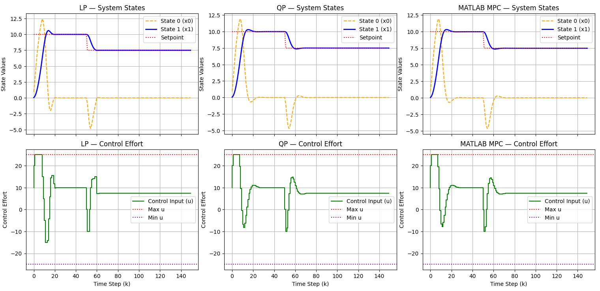
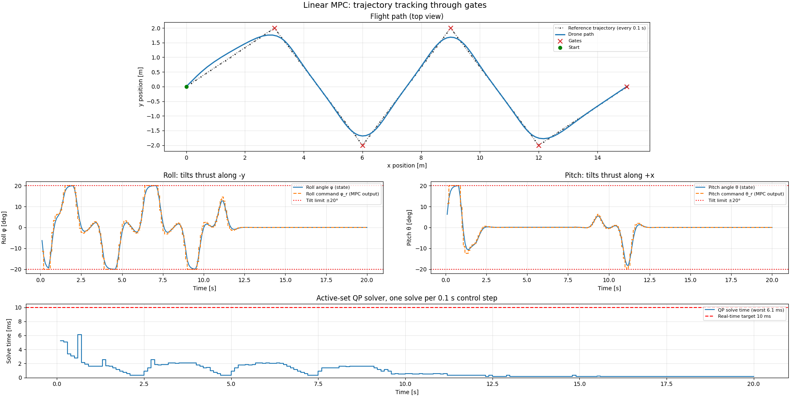

# Control Toolbox (C++)

This is my personal passion project C++ library for modern control and optimization algorithms. The goal of this repository is to learn
control theory and optimization and the implementation of these in C++. I am building the algorithms from scratch myself to learn how they work.
The rule for this project is to never use any other external libraries than the C++ standard library. The goal is that the developed algorithms are
robust and efficient enough to be used in real-world aplications.
## Key Features
- Model Predictive Control (MPC): Formulated for Linear TIme-invariant (LTI) MIMO systems. Supports Linear and Quadratic cost functions.
- Custom optimization algorithms
    - Simplex algorithm:
    - Active Set algortihm: 
- PID control: Both algorithm support antiwindup
    - Positional PID-control algorithm
    - Velocity form PID-control algorithm

## Validation and results
The C++ implementations in this library are verifies against MATLAB. Simplex- and Active Set -algortihms were tested against matlab
and gave same results. The MPC-algortihm was also tested against matlab and gave almost identical results. 

MPC-algortihm was tested on a 2 state integrator system and as seen below the results are almost identical to matlabs with the QP-cost



After MPc validation against matlab the MPC has been tested on a 8 state drone model which was linearized around hover. 
states:
x = [px, py, pz, vx, vy, vz, phi, theta]^T
controls:
u = [phi_r, theta_r, T]^T
where phi is the pith and theta s the roll and phi_r and theta_r are the setpoints given to the attitude controller. The attitude controller is part of the model and it is modeled as a first order system which is an aproximation of a second order system. Source for state space model is "Model Predictive Control for Trajectory
Tracking of Unmanned Aerial Vehicles Using
Robot Operating System" by Mina Kamel, Thomas Stastny, Kostas Alexis and Roland Siegwart.

Parameters used are illustrative and not identified from a real drone and the state space system was discretized with matlabs c2d using ZOH.

The MPC had horizon of 20, tilt was limited to +-20 degrees, tilt rate to 0.2 rad/s and thrust between 0.3g and 1.8 g. The trajectory was designed to be flown at 2 m/s. Results on the simulation can be seen below.



The test were done on the exact same plant which the MPC used and no disturbances were added. In reality there would be model mismatch and noise. The trajectory starts at the full 2 m/s and drone starts at 0 m/s which causes some deviation from trajectory at the first segment before first gate. The solve time stays under 10 ms on my laptop with ryzen 5 4500U. In the future this will also be tested on the jetson with the same goal of worst case solve time being under 10 ms.

## Building tests

This project uses CMake. From the repo root:

```bash
mkdir build && cd build
cmake ..
cmake --build .
```

This builds `simplex_test`, `active_set_test`, and `mpc_test` into the `build/` folder. 

## Running tests
### MPC solver for Linear time invariant MIMO systems
run the code:
```
./mpc_test
```

### Active set algorithm
run the code:
```
./active_set_test
```

### Simplex algorithm
run the code:
```
./simplex_test
```

### Hover linearized drone tests
run the code:
```
./linear_drone
python .\plot_quad_trajectory.py --file results_quad_waypoints.csv
```

## Roadmap and future plans
I'm Currently working on implementing a system/plant class to streamline simulations and system definitions. Improvements and test for the PID class are also being worked on.

### Next features
- State feedback controller
- State predictor
- Kitagawa algorithm
- Kalman predictor
- Kalman filter